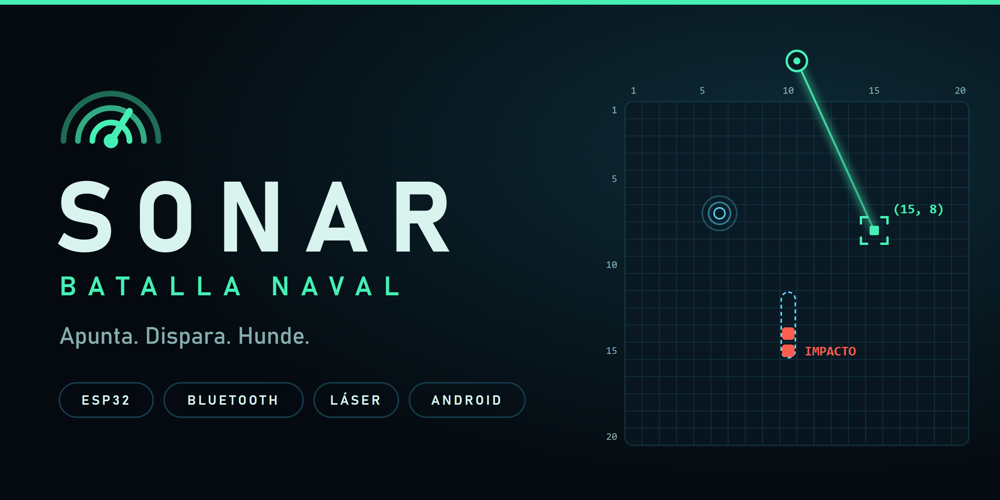
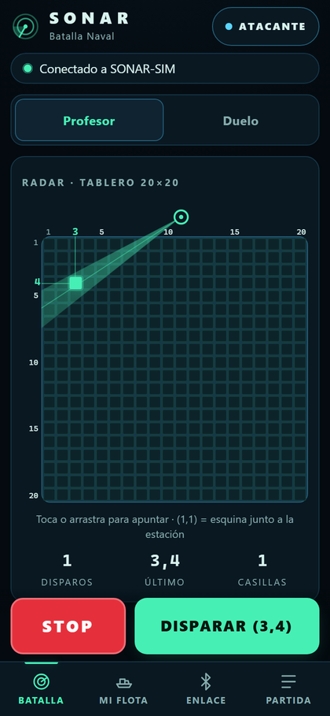
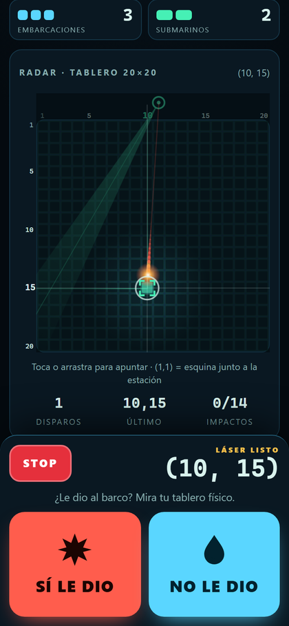
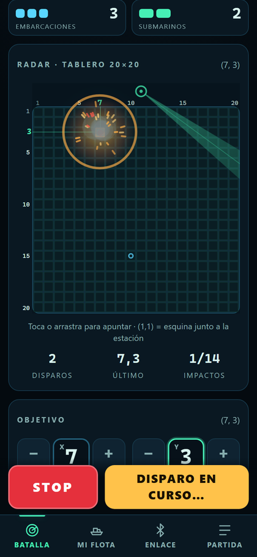
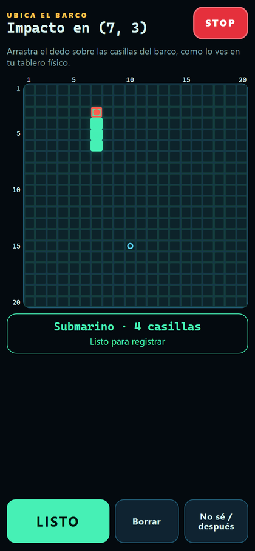
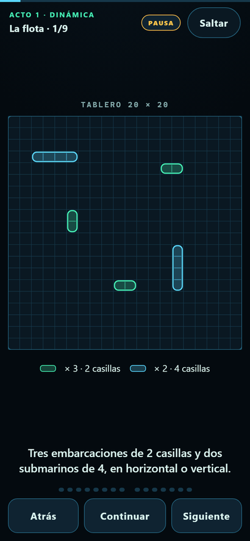

<p align="center">
  
</p>

<p align="center">
  
  
  
  
  
</p>

**SONAR** es una Batalla Naval **física y automatizada**: un láser montado en una torreta pan-tilt (ESP32 + 2 servos) aparece en la coordenada `(x, y)` del tablero rival, y una **app Android propia** —animada, con tutorial— controla el disparo por Bluetooth. Proyecto final de *Fundamentos de Ingeniería Mecatrónica* (UAO, 2026).

## El juego

- Tablero de **30 × 30 cm** con matriz de **20 × 20 casillas de 1 cm**, elevada 5 cm.
- Cada equipo coloca su flota en **su** tablero: **3 embarcaciones de 2 casillas** y **2 submarinos de 4**, en horizontal o vertical (14 casillas).
- El rival maneja **tu** tablero por Bluetooth: manda una coordenada, **primero `x`, luego `y`**, y el láser aparece ahí.
- Una casilla del barco alcanzada es un impacto. **Un testigo da fe**: los defensores miran su tablero y dicen «le dio» o «no le dio».
- Gana quien hunda toda la flota rival.

## Cómo se ve la app

| Radar | Pausa del veredicto | Impacto | Ubicar el barco | Tutorial |
|:--:|:--:|:--:|:--:|:--:|
|  |  |  |  |  |

1. **Apuntar** tocando el radar o tecleando `x, y`, y **DISPARAR** (STOP siempre a la vista).
2. El proyectil vuela y, **justo antes del impacto, el tiempo se congela**: los estudiantes eligen **SÍ LE DIO / NO LE DIO** tras mirar su tablero.
3. *No le dio:* una gota de agua y se sigue. *Sí le dio:* explosión, y **«Ubica el barco»**: arrastras el dedo sobre sus casillas.
4. Con el barco ubicado, los siguientes impactos son directos; al caer todas sus casillas, **¡HUNDIDO!**; con los cinco, victoria.
5. Al abrir por primera vez, un **tutorial animado** explica primero la dinámica del juego y luego la interfaz.

Extras: **TEST de 5 posiciones** con progreso, asistente de tiro (mapa de calor), bitácora, estadísticas, exportar JSON/CSV, calibración de la torreta y un **módulo simulado** para practicar sin hardware.

## Arquitectura

```
 Celular (app SONAR, Android)                       Módulo (ESP32 clásico)
 ┌──────────────────────────────┐   Bluetooth SPP   ┌────────────────────────────┐
 │ UI Preact · animaciones      │ ───────────────▶ │ transporte BT / USB / Wi-Fi │
 │ estado · ciclo de disparo    │   (x,y) · TEST    │ protocolo de líneas         │
 │ núcleo de reglas (TS)        │ ◀─────────────── │ controlador · geometría     │
 │ transportes BT / Wi-Fi / sim │   OK · ERR · PONG │ servos pan-tilt · láser     │
 └──────────────────────────────┘                   └────────────────────────────┘
```

- **Protocolo de texto**, una línea por mensaje (`(x,y)`, `TEST`, `STOP`, `PING`, `HELLO`…): [`docs/03-firmware-y-app/PROTOCOLO.md`](docs/03-firmware-y-app/PROTOCOLO.md). Lo hablan igual Bluetooth, USB y el Wi-Fi de mantenimiento.
- **Seguridad del láser:** apagado desde el arranque, `STOP` inmediato (no hace cola detrás de un disparo), encendido solo con la torreta quieta y límites de ángulo.
- La lógica es **pura y probada en el PC** (`lib/core` en C++, `app/src/core` en TypeScript); el hardware queda detrás de una capa mínima.

## Empezar

**Firmware** (ESP32 **clásico** WROOM-32; el S3/S2/C3 no tienen Bluetooth clásico):

```bash
pio run -e modulo_a -t upload   # el módulo B: -e modulo_b
pio device monitor              # 115200; escribe PING → PONG SONAR-A 0.1.0
pio test -e native              # 52 pruebas de lib/core en el PC
```

El módulo se anuncia como **`SONAR-A`** / **`SONAR-B`**: empárejalo en los ajustes del celular antes de abrir la app. Puesta en marcha paso a paso: [`BRINGUP.md`](docs/03-firmware-y-app/BRINGUP.md).

**App** (Node 18+, JDK de Android Studio, Android SDK):

```bash
cd app
npm install
npm run dev        # en el navegador con el módulo simulado
npm test           # 225 pruebas (Vitest)
npm run apk        # → app/dist-apk/SONAR-<versión>-debug.apk
adb install -r app/dist-apk/SONAR-0.1.0-debug.apk
```

Detalles y requisitos: [`app/LEEME.md`](app/LEEME.md).

## Estructura

| Ruta | Qué es |
|---|---|
| `app/` | **app Android** (Vite + Preact + TypeScript + Capacitor): núcleo, transportes, estado, UI, tutorial |
| `lib/core/` · `lib/hal_esp32/` · `src/` · `include/` | firmware: lógica pura, hardware del ESP32, transportes, pines y constantes |
| `web/index.html` | panel web (modo mantenimiento del módulo y iPhone) |
| `test/` · `tools/` | pruebas Unity y simuladores/e2e (`fake_device.py`, `sim_phone.py`, `e2e_web.py`) |
| `docs/` | documentación completa: empieza por [`docs/ESTADO.md`](docs/ESTADO.md) |
| `cad/` | modelo y planos del maletín |
| `branding/` | logotipo, paleta y banner ([guía](branding/BRANDING.md)) |
| `registro/` | capturas y resultados de las pruebas |

## Estado y verificación

| Qué | Resultado |
|---|---|
| Núcleo del firmware (Unity, en el PC) | **52 / 52** |
| App: núcleo, transportes y estado (Vitest) | **225 / 225** |
| App de punta a punta con módulo simulado (Playwright, 375×812) | **32 + 23 + 30** comprobaciones |
| Panel web y protocolo simulado | **29 / 29** · **24 / 24** |
| Firmware `modulo_a` compila | RAM 18 %, Flash 51 % |
| **Con hardware real** (ESP32, servos, láser, Bluetooth) | **en pruebas** |

## Documentación

- [`docs/ESTADO.md`](docs/ESTADO.md) — decisiones, calendario y pendientes (fuente de verdad).
- [`docs/03-firmware-y-app/APP_SONAR.md`](docs/03-firmware-y-app/APP_SONAR.md) — plan y diseño de la app.
- [`docs/README.md`](docs/README.md) — índice completo (diseño, electrónica, compras, publicación).

## Licencia

Código bajo **MIT** ([`LICENSE`](LICENSE)); documentación CC BY-SA y hardware CERN-OHL: ver [`docs/05-publicacion/LICENCIAS.md`](docs/05-publicacion/LICENCIAS.md).
